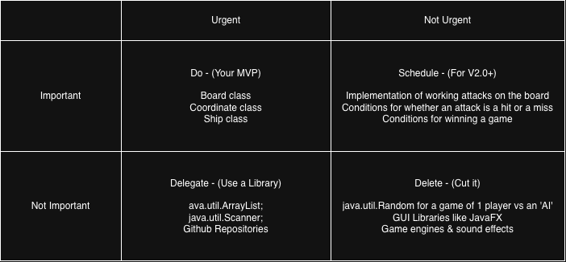

# Battleship-Repo
Final Project for CS 193 where 2 players can play a game of Battheship on Terminal.

## Creating Simple Games in Java

I've enjoyed Java projects where I design and implement a simple game. I have already 
done this with Connect 4 in CS 180, and with a cards game and advanced Tic-Tac-Toe in 
high school classes of mine. So I decided I'll do something similar, this time with
Battleship.

## How It Works

The Battleship board is set up, and each player is asked for input of where on the board
they will place their battleships. The program receives player input on where on the
opponent's board to attack. Switches back and forth between Player 1 & 2. Ships of each
get hits on them until one player has all their ships sunk, and then the other player wins.

## Tech Stack

- **Language:** Java
- **Libraries:** ava.util.ArrayList & java.util.Scanner
- **External tools:** Github

## Roadmap

Features you haven't built yet but plan to (pull these from your
"Schedule" quadrant in the Eisenhower Matrix).

- [ ] Create classes for the game board and the coordinates required to run the game.
- [ ] Create class for the 5 different types of ships used in the game.
- [ ] Implement ships and their placement in the overall game's game board, so that
they fit on the board, and don't overlap.
- [ ] Creating either a new class or a main.java to have a loop that has 2 players
using the board and implementing ships/attacks over and over again until one player
wins by having the opponent's 5 ships sunk.
- [ ] Implementation of how attacks would work (hits & misses), and how they determine
whether an opponent's ships has sunk.

## Author

Avighna Mukherjee, https://github.com/avighnamukherjee08-hub/Battleship-Repo
